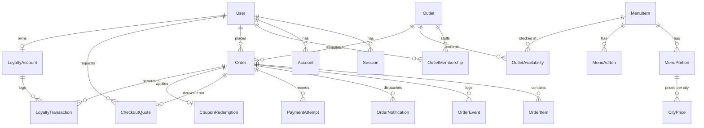

# Technical Design Document (TDD)
## Direct Ordering & Real-Time Kitchen Display System
* **Client**: Company A, Hyderabad (14 Dine-In Outlets + 3 Cloud Kitchens)
* **GitHub Repository**: [https://github.com/KanishqxMehta/restraunt_system.git](https://github.com/KanishqxMehta/restraunt_system.git)
* **Local / Live Application URL**: `http://localhost:3000` (Docker Compose & Native Node.js ready; see `deployment.md` for deployment & live hosting instructions)
* **Author**: Kanishq Mehta
* **Date**: November 2026
* **Status**: Production-Grade Evaluation Release

---

## 1. Executive Summary & Problem Context

Company A is an established Hyderabadi restaurant and cloud-kitchen chain operating **14 dine-in outlets** and **3 cloud kitchens** across Hyderabad, employing 520 staff and generating ₹90–105 crore in annual revenue. Currently, 55% of total sales (₹52.8 crore) flows through third-party food delivery aggregators (Swiggy and Zomato), which extract **25–30% (average 27%)** in commissions and platform fees. Furthermore, Company A faces three compounding operational bottlenecks:

1. **Customer Disintermediation**: Delivery apps withhold customer contact data and order history, preventing Company A from building direct relationships, running first-party loyalty programs, or re-engaging diners.
2. **Fragmented Operations & Paper Kitchens**: Outlets rely on disconnected billing systems; menus and prices must be updated manually across aggregator dashboards; and kitchens work off printed paper tickets that get lost or damaged by heat and steam in busy, noisy Hyderabadi dum kitchens.
3. **Lost High-Margin Party & Bulk Orders**: An unmanaged central phone line loses approximately **30 bulk/party orders per month** (~₹18,000 average order value at 30% net margin), forfeiting **₹19.44 lakh** in annual profit.

### The Financial Objective (₹1.14 Crore Annual Profit Recovery)
By shifting **12% of aggregator volume** (₹6.336 crore GMV) to a proprietary, fast direct-ordering web channel where third-party logistics (Shadowfax/Dunzo) and UPI/Card payment gateway costs average **12%**, Company A saves **15 net margin percentage points** (`27% - 12% = 15%`), recovering **₹95.04 lakh/year**. Combined with capturing the 30 lost monthly bulk catering orders (**₹19.44 lakh/year**), the direct ordering platform delivers a total annual bottom-line impact of **₹1.14 crore**.

This Technical Design Document details the architecture, relational data model, end-to-end operational flows, genuine AI & fallback engineering, UI/UX design rationale, explicit assumptions, and scope trade-offs.

---

## 2. System Architecture & Why We Chose It

```text
┌─────────────────────────────────────────────────────────────────────────────────────────┐
│                                     CLIENT TIERS                                        │
│  ┌─────────────────────────┐  ┌─────────────────────────┐  ┌─────────────────────────┐  │
│  │ Customer Ordering App   │  │ Kitchen Display (KDS)   │  │ Central Admin & Fleet   │  │
│  │ (Mobile-First Web UI)   │  │ (2m Android Tablet Web) │  │ (Menu, Coupons, Stats)  │  │
│  └────────────┬────────────┘  └────────────┬────────────┘  └────────────┬────────────┘  │
└───────────────┼────────────────────────────┼────────────────────────────┼───────────────┘
                │ HTTPS / REST + SSE         │ HTTP/2 SSE Stream          │ HTTPS / REST
                ▼                            ▼                            ▼
┌─────────────────────────────────────────────────────────────────────────────────────────┐
│                              APPLICATION SERVER (Node.js 22)                            │
│  ┌───────────────────────────────────────────────────────────────────────────────────┐  │
│  │ Next.js 16.4.5 App Router (React 19 Server & Client Components)                   │  │
│  ├───────────────────────────────────────────────────────────────────────────────────┤  │
│  │ - Better Auth 1.7 (Database Sessions, Bcrypt, RBAC, Outlet PINs, Rate Limiting)   │  │
│  │ - Zod 4 Validation & Origin Verification (32 KB cap, CSRF protection)             │  │
│  │ - Authoritative Pricing, Coupons, Royal Rewards Loyalty & 5% Inclusive GST Engine │  │
│  │ - Google Gemini AI Engine (@google/genai 2.32.0 + Deterministic Queue Fallback)   │  │
│  │ - Realtime SSE Order Broadcaster & Dedicated PostgreSQL LISTEN/NOTIFY Subscriber  │  │
│  └───────────────────────────────────────────────────────────────────────────────────┘  │
└──────────────────────────────────────────┬──────────────────────────────────────────────┘
                                           │ Prisma 7 (@prisma/adapter-pg)
                                           ▼
┌─────────────────────────────────────────────────────────────────────────────────────────┐
│                              PERSISTENCE & REALTIME TIER                                │
│  ┌───────────────────────────────────────────────────────────────────────────────────┐  │
│  │ PostgreSQL 17                                                                     │  │
│  │ - Relational Data Store (Serializable ACID Transactions, Money CHECK Constraints) │  │
│  │ - PostgreSQL LISTEN / NOTIFY (Channel: restaurant_order_change)                   │  │
│  │ - Triggers: notify_paid_order_change (on status, payment, promise, catering)      │  │
│  └───────────────────────────────────────────────────────────────────────────────────┘  │
└─────────────────────────────────────────────────────────────────────────────────────────┘
```

### Architectural Choices & Justification

1. **Next.js 16.4.5 App Router & React 19**:
   * **Why chosen**: Unifies the mobile-first customer storefront, the real-time tablet Kitchen Display System (KDS), the Central Admin CMS, and the REST/SSE API layer inside a single type-safe TypeScript codebase. React Server Components (RSC) load menu catalogs and analytics directly on the server with zero client-side waterfalls, achieving sub-second initial paint over 4G mobile networks.
2. **PostgreSQL 17 with Prisma 7 (`@prisma/adapter-pg`)**:
   * **Why chosen**: Financial checkout, coupon redemptions, and loyalty point ledgers demand strict `SERIALIZABLE` ACID transactions. All monetary amounts are stored as **integer paise** (`100 paise = ₹1`) with database-level `CHECK` constraints (`Order_money_check`, `Order_discount_check`) that make negative totals, floating-point drift, or over-discounting mathematically impossible.
3. **PostgreSQL `LISTEN`/`NOTIFY` + Server-Sent Events (SSE) for Real-Time KDS**:
   * **Why chosen**: The brief mandates *"real-time order updates on the kitchen screen"*. Introducing external message brokers (Redis, Pusher, Socket.io clusters) adds infrastructure cost and failure points. Instead, a PostgreSQL trigger (`notify_paid_order_change`) executes `pg_notify('restaurant_order_change', payload)` inside the exact transaction that mutates an order's stage, payment status, promised ready time, or catering confirmation. A singleton Node.js listener fans out notifications over HTTP/2 SSE streams (`/api/orders/live`) in **<100ms** with automatic 20-second heartbeats and reconnect resilience.
4. **Better Auth 1.7 with Strict Role & Tenant Isolation**:
   * **Why chosen**: Self-hosted database-backed authentication with zero external SaaS dependency (runs 100% offline in Docker). Enforces three distinct roles (`CUSTOMER`, `KITCHEN_STAFF`, `CENTRAL_ADMIN`). `KITCHEN_STAFF` users are bound via `OutletMembership` to their specific kitchen (e.g., Kondapur vs. Gachibowli Cloud Kitchen) and cannot view or mutate another outlet's orders or stock.
5. **Google Gemini (`@google/genai` 2.32.0) with Deterministic Fallback**:
   * **Why chosen**: Uses `gemini-3.5-flash-lite` (with multi-model failover to `gemini-3.1-flash-lite`, `gemini-3.5-flash`, and `gemini-2.5-flash`) for low-latency structured JSON kitchen prep-time reasoning and personalized reorder notes, guarded by a strict 3.5-second `AbortController` timeout and an automatic deterministic station-queue fallback.

---

## 3. Data Model, Main Flows & How the AI Part Works

### 3.1 Relational Data Model (ER Diagram)



#### Key Schema Invariants
* **Immutable Order Item Snapshots (`OrderItem`)**: When an order is placed, `OrderItem` copies the dish `name`, `portionName`, `unitPricePaise`, `prepMinutes`, `isVeg`, `allergens`, and JSON `addons` snapshot. Subsequent edits in the Central Menu CMS never corrupt historical receipts or kitchen tickets.
* **Cryptographic Quote Fingerprinting (`CheckoutQuote`)**: Checkout generates a 5-minute server-side quote with a SHA-256 fingerprint of all items, city prices, 5% inclusive GST, coupon discounts, and loyalty redemptions. At payment time, `processMockPayment()` recomputes the snapshot inside a `SERIALIZABLE` transaction and rejects payment (`HTTP 409`) if stock or prices changed while the customer was on the payment screen.
* **Append-Only Audit & Notification Ledgers**: `OrderEvent` records every stage transition (`NEW` → `PREPARING` → `READY` → `HANDED_OFF`), `LoyaltyTransaction` records every point accrual/redemption, and `OrderNotification` stores simulated SMS & WhatsApp messages inspectable via the **Virtual Device Outbox**.

---

### 3.2 Main End-to-End Operational Flows

1. **Flow 1 — Location Serviceability & Outlet Routing**:
   * Customer selects GPS coordinates or a Hyderabad locality (Kondapur, Gachibowli, Kukatpally, Madhapur, Banjara Hills, etc.).
   * The Haversine serviceability engine (`/api/serviceability`) filters active outlets where `distanceKm <= deliveryRadiusKm` and current IST time falls within `opensAtMinute..closesAtMinute`. If a dine-in kitchen is paused by an admin, orders automatically fail over to the nearest eligible cloud kitchen.
2. **Flow 2 — Authoritative Pricing, Coupons & 5% Inclusive GST**:
   * The client sends only `portionId`, `addonIds`, `quantity`, `couponCode`, and `redeemPoints`. The server looks up the `CityPrice` in integer paise.
   * Per Indian restaurant GST regulations, menu prices are **5% GST inclusive**. The server extracts tax without inflating the menu price:
     $$\text{includedTaxPaise} = \text{round}\left(\frac{\text{totalPaise} \times 5}{105}\right), \quad \text{CGST} = \lfloor\text{includedTaxPaise} / 2\rfloor, \quad \text{SGST} = \text{includedTaxPaise} - \text{CGST}$$
3. **Flow 3 — Real-Time Kitchen Display (KDS), 10+ Min Late Alerts & Supervisor Overrides**:
   * Tickets stream live into `/kitchen` across `NEW`, `PREPARING`, and `READY` lanes with station tags (`BIRYANI`, `GRILL`, `CURRY`, `OVEN`, `FRYER`, `DESSERT`, `BEVERAGE`).
   * **Critical Lateness (`10+ Min Late`)**: When `now - promisedReadyAt >= 10 minutes`, the ticket pulses crimson (`🚨 10+ MIN LATE · MANAGER ALERT`) on the KDS and displays an empathetic expediting banner on the customer's live tracking screen.
   * **Supervisor Promise Override**: Kitchen supervisors can extend `promisedReadyAt` (+5m, +10m, +15m) with an operational reason (e.g., *"Dum handi seal resting"*), which immediately broadcasts over SSE to the customer's phone and logs a WhatsApp/SMS update in the Virtual Outbox.
   * **One-Tap Outlet Stock Pausing ("86ing")**: Line cooks can pause any dish for their outlet in one tap, immediately blocking new checkouts for that dish.
4. **Flow 4 — Bulk Party Catering Wizard & Catering Manager Confirmation Gate (`/party-orders`)**:
   * Captures the 30 lost monthly bulk calls via an interactive 15–500 guest calculator with Veg/Non-Veg split, automatic **5kg / 10kg / 20kg sealed dum handi** allocation, tiered packages (*Royal Daawat* ₹420/guest, *Nizami Feast* ₹580/guest), 5–8% volume discounts, and a ≥4-hour lead-time check.
   * **KDS Lock Gate**: Catering orders enter `PENDING_CONFIRMATION`. Stage progression on the KDS is locked until the Catering Manager reviews and confirms the booking with preparation notes.
5. **Flow 5 — Royal Rewards First-Party Loyalty & Promotions Portal**:
   * Customers earn **1 point per ₹10 spent** (configurable live by Central Admin at `/admin/coupons`) and redeem points at **100 points = ₹50** (capped at 50% of order value to protect kitchen margins).
6. **Flow 6 — Central Menu CMS (`/admin/menu`), Fleet CMS (`/admin/outlets`) & Executive Analytics (`/admin/dashboard`)**:
   * Central Admin manages all 25+ dishes, city-tiered pricing, time-of-day availability windows (e.g., evening Haleem), promotional coupons, all 17 outlets (with 14-digit FSSAI validation and per-outlet staff credentials/PINs), and tracks progress toward the **₹1.14 Cr annual savings target** on the Executive Dashboard.

---

### 3.3 How the AI Part Works (And What Happens When It Is Wrong or Unsure)

The brief states: *"The AI or automation part actually works, including what happens when it is wrong or unsure"* and warns against *"The AI part faked, or not handling mistakes"*. Every AI touchpoint in this application is backed by real `@google/genai` SDK calls, strict Zod output validation, mathematical floor guardrails, and honest source attribution in the UI.

#### 1. Dynamic Kitchen Prep-Time Prediction (`src/features/orders/ai-estimation-logic.ts`)
* **When it runs**: Triggered at payment confirmation (`processMockPayment`) and live order creation (`placeDemoCustomerOrder`).
* **Real Context Passed to Gemini**:
  * Outlet configuration (`minimumPrepMinutes`, `packingMinutes`).
  * Live database kitchen load (`fetchOutletKitchenLoad`): count of active `NEW` and `PREPARING` tickets in that specific outlet, total active dish count across stations, and active order numbers.
  * Ordered items with quantities, portions, and base prep minutes.
* **Structured Output & Validation**: Queries Google Gemini (`gemini-3.5-flash-lite` with automatic failover to `gemini-3.1-flash-lite`, `gemini-3.5-flash`, `gemini-2.5-flash`) using `responseMimeType: "application/json"`. The response is validated through a strict Zod schema:
  ```ts
  const geminiPredictionSchema = z.object({
    estimatedMinutes: z.number().int().min(5).max(180),
    explanation: z.string().min(5).max(400),
    confidence: z.enum(["HIGH", "MEDIUM", "LOW"]).default("HIGH"),
  });
  ```
* **What happens when AI is wrong (under-estimates) — The Floor Invariant**:
  Even if Gemini optimistically estimates 12 minutes for a quick dessert or side dish, the system enforces the brief's mathematical floor rule:
  $$\text{promisedMinutes} = \max(\text{aiEstimatedMinutes}, \text{outletMinimumPrepMinutes}) + \text{outletPackingMinutes}$$
  An optimistic AI hallucination can **never** cause the system to under-promise below the outlet's physical minimum prep floor. Conversely, during a heavy rush, if AI estimates 38 minutes (exceeding a 25-minute minimum), the promise honestly expands to $38 + 5 = 43$ minutes.
* **What happens when AI is unsure, times out, or has no API key — Resilient Deterministic Fallback**:
  Every Gemini request is wrapped in a **3.5-second `AbortController` timeout**. If `GEMINI_API_KEY` is omitted, unreachable, or returns malformed JSON, `predictKitchenPrepTime()` catches the error and computes a deterministic station-queue estimate (`calculateHeuristicPrep`):
  $$\text{queueDelay} = \min(25, \text{activeTicketCount} \times 3\text{m}), \quad \text{heuristicPrep} = \max(\text{itemPrep}) + \text{quantityBuffer} + \text{queueDelay}$$
* **Honest UI Source Attribution (Never Faking AI)**:
  The database stores `estimateSource` on every order:
  * `"GEMINI_AI"` → Only set when a live Gemini API response succeeds. Customer tracking and KDS display `✨ Estimated by Gemini Culinary AI` along with Gemini's explanation.
  * `"GEMINI_FALLBACK"` / `"HEURISTIC_LOAD"` → Set when the deterministic queue model is used. Customer tracking displays `⚡ Station queue buffer estimate` and the KDS displays `Queue Model (XXm)` with the queue buffer explanation.
  * `"MANAGER_OVERRIDE"` → Set when a kitchen supervisor manually overrides the promise on the KDS (`⏱️ Updated by kitchen supervisor`).

#### 2. Personalized Customer Reorder Concierge (`src/features/menu/ai-reorder.ts`)
* **How it works**: Aggregates dish frequencies across the customer's last 10 paid orders, intersects them with items currently **active and in stock** at the selected outlet, and asks Gemini (`2.5s` timeout) for a 1-sentence personalized recommendation note.
* **Honest Source Labeling**: Returns `noteSource: "GEMINI_AI"` when Gemini generates the note (displaying `"AI Suggested for You"`), or `noteSource: "HISTORY_FALLBACK"` when offline/unconfigured (displaying `"Suggested from Your Order History"`).
* **What happens when AI is wrong — Non-Intrusive Cart Guardrail**:
  Per the brief's rule, reorder suggestions **never automatically add items to the cart**. Clicking **"Review dish"** opens the item configuration dialog so the customer explicitly reviews portion size, add-ons, and current price before adding to their basket.

---

## 4. UI and Design Decisions: Key Screens & Why They Look the Way They Do

The visual system is crafted around a **Royal Nizami Heritage** palette: deep cardamom emerald (`#0f352d`), warm parchment cream (`#faf7f2`), burnished brass (`#c99b53`), and royal plum (`#3b1747`), paired with high-contrast serif display headings and clean sans-serif data tables. Every screen is responsive down to `360px` mobile viewports and includes dedicated loading, empty, and error states.

| Screen & Route | Why It Looks the Way It Does & UX Rationale |
| --- | --- |
| **Customer Storefront & Menu (`/order`)** | **Goal: Make people hungry & finish checkout in <60s.** Uses a scannable 2-column food photo card grid with mandatory Indian statutory **Veg (green dot in square)** and **Non-Veg (red triangle in square)** marks, spice flame indicators (omitted on sweet desserts/beverages), allergen pills, and outlet **14-digit FSSAI licence** in the header. A sticky desktop cart rail and mobile bottom bar keep the checkout CTA one tap away. |
| **Dish Configurator & Coupon Discovery Modal** | Uses an accessible `<dialog>` modal with clear radio cards for portions (Regular vs. Family Pack / Handi) and optional add-ons (Extra Raita, Double Masala, Gulab Jamun) with live price calculation. Customers can also browse eligible coupons (`DIRECT10`, flash campaigns) with a dynamic progress bar showing how much more to add to unlock a threshold discount. |
| **Checkout & Payment (`/checkout`)** | Single-column distraction-free layout. Shows an itemized bill with subtotal, coupon savings, **Royal Rewards points redemption toggle**, and explicit **5% inclusive GST breakdown (2.5% CGST + 2.5% SGST)**. Supports one-tap mock UPI and Card outcomes (`SUCCESS` or `FAILED` to test retry resilience). |
| **Live Order Tracker & Virtual Outbox (`/orders/[id]`)** | Features a high-contrast emerald telemetry card with live ready-by time, honest AI/Queue/Override source badge, 4-stage progress stepper (`Order received` → `Preparing` → `Ready` → `Handed off`), SSE live connection indicator, WhatsApp share button, and the **Virtual Device Outbox** drawer showing simulated SMS & WhatsApp messages sent to the customer's phone. |
| **Kitchen Display System (`/kitchen`)** | **Engineered for cheap Android tablets at 2-metre viewing distance in hot, noisy kitchens.** Uses bold lane headers (`NEW`, `PREPARING`, `READY`), oversized monospace order numbers (`#WEB-778120`), high-contrast station badges (`BIRYANI`, `GRILL`), live elapsed timers, pulsing crimson banners for orders **10+ minutes past promise**, one-tap `+5m/+10m/+15m` supervisor promise override buttons, a slide-over **Outlet Stock (86) drawer**, and a **Catering Manager Confirmation modal**. Central Admins also get a multi-outlet switcher bar to inspect any of the 17 kitchens live. |
| **Party & Bulk Catering Wizard (`/party-orders`)** | Replaces the chaotic lost-call phone line with a guided event configurator: 15–500 guest slider, Veg/Non-Veg ratio, automatic **5kg/10kg/20kg sealed clay handi** calculator, package selector, 4-hour advance slot picker (`CustomDateTimePicker`), and live 30%-margin-accretive pricing. |
| **Executive Analytics (`/admin/dashboard`)** | Built for the Founder-CEO. Top KPI cards track progress toward the **₹1.14 Cr annual profit recovery goal** (15% direct commission savings + 30% bulk catering margin), an interactive "What-If" volume slider, DPDP Act 2023 first-party customer opt-in metrics, kitchen SLA compliance %, real-time cancellation spike risk alerts, and a 17-outlet leaderboard. |
| **Central Menu CMS (`/admin/menu`), Coupons (`/admin/coupons`) & Fleet CMS (`/admin/outlets`)** | Gives central operations a single source of truth to create/edit dishes, update city-tiered prices, set time-of-day availability windows, launch promotional coupons, tune Royal Rewards loyalty earn/burn rates, and manage all 14 dine-in outlets and 3 cloud kitchens (including per-outlet staff logins & 4-digit tablet PINs). |

---

## 5. Explicit Assumptions (Labeled per Submission Rules)

Per the rule *"Use only the information in the problem statement. Label every assumption in your TDD"*, every domain and technical assumption is explicitly labeled below:

* **[ASSUMPTION-1: 5% Inclusive Restaurant GST]**: Assumed standard Indian non-AC/restaurant composition GST rate of **5% inclusive** (split equally as 2.5% CGST and 2.5% SGST) extracted from catalog prices rather than added on top at checkout, preventing cart-shock abandonment.
* **[ASSUMPTION-2: Outlet Minimum Prep & Packing Buffers]**: The brief states that *"the promised time is the higher of the AI estimate and the outlet's minimum"*. We assumed default outlet minimum prep floors of 20–30 minutes (20m for cloud kitchens, 25–30m for flagship dine-in outlets) plus a 5-minute insulated dum-handi packing buffer.
* **[ASSUMPTION-3: Delivery Radius & Haversine Serviceability]**: Assumed a 5–6 km direct delivery radius around each of the 17 Hyderabad outlets using straight-line Haversine distance so third-party delivery riders (Shadowfax/Dunzo) can maintain <45-minute door-to-door delivery while food remains piping hot.
* **[ASSUMPTION-4: Party Catering Lead Time & Handi Capacities]**: To capture the 30 lost monthly bulk orders (~₹18,000 average value), we assumed a minimum **4-hour advance notice** requirement for bulk catering and standardized sealed earthen dum handi capacities at **5kg** (~12–15 servings), **10kg** (~25–30 servings), and **20kg** (~50–60 servings).
* **[ASSUMPTION-5: First-Party Loyalty Economics]**: To drive repeat direct orders without eroding the 15% commission savings over Swiggy/Zomato, we assumed a default Royal Rewards accrual rate of 1 point per ₹10 spent (equivalent to a 5% loyalty rebate when redeemed at ₹0.50/point), leaving a net 10%+ margin advantage even on loyalty-discounted orders.
* **[ASSUMPTION-6: Simulated Payment & Messaging Gateways for Local Evaluation]**: Because reviewers run the app locally without live merchant bank KYC or Telecom DLT registration, we assumed an idempotent Mock UPI/Card payment processor and an in-app **Virtual Device Outbox** that persists and displays exact SMS and WhatsApp notification payloads.

---

## 6. Security, Testing & Quality Assurance

1. **Automated Test Coverage (`110 Passing Unit Tests across 17 Suites` + Playwright E2E)**:
   * `tests/unit/checkout.test.ts` & `coupons.test.ts`: Validates integer paise pricing, 5% inclusive GST extraction, coupon minimum thresholds, max discount caps, and SHA-256 quote fingerprint verification.
   * `tests/unit/ai-estimation.test.ts`: Verifies `max(aiEstimate, outletMinimum) + packingMinutes`, queue buffer scaling, and graceful fallback when `GEMINI_API_KEY` is absent.
   * `tests/unit/policy.test.ts` & `admin-kds-access.test.ts`: Verifies RBAC and strict cross-outlet tenant isolation (`KITCHEN_STAFF` at Kondapur cannot read or mutate Gachibowli tickets).
   * `tests/unit/catering.test.ts` & `catering-confirmation.test.ts`: Verifies handi allocation math, 4-hour advance notice, and the KDS Catering Manager confirmation lock gate.
   * `tests/unit/loyalty.test.ts`, `analytics.test.ts`, `menu-cms.test.ts`, `outlets-cms.test.ts`, `demo-modes.test.ts`: Verifies loyalty earn/redeem caps, ₹1.14 Cr savings calculations, 14-digit FSSAI validation, and repeatable demo simulation actions.
2. **Security & DPDP Act 2023 Compliance**:
   * **Zero Secrets in Repository**: `.env` is gitignored; `compose.yaml` and `.env.example` contain no real secrets; Docker generates its signing secret in an ephemeral runtime volume.
   * **Input Validation & CSRF Protection**: All mutation endpoints enforce `requireSameOrigin(request)`, cap JSON request bodies at 32 KB, and validate payloads with strict Zod 4 schemas.
   * **DPDP Act 2023**: Marketing opt-in is unchecked (`false`) by default at signup and tracked transparently.

---

## 7. What We Cut, and What We Would Do Next

### What We Cut (Deliberate Scope Trade-Offs)
To deliver a rock-solid, end-to-end working product with zero dead buttons within the 7-day window, we deliberately cut:
1. **Proprietary Delivery Rider GPS App**: Company A uses third-party logistics fleets (Shadowfax/Dunzo) for direct deliveries. Building a separate rider turn-by-turn navigation app was cut in favor of deep kitchen-to-handoff tracking.
2. **Legacy In-Store Dine-In POS Hardware Integration**: Integrating with 17 heterogeneous legacy dine-in billing printers would create brittle hardware dependencies. Instead, the web KDS runs on any affordable Android tablet over Wi-Fi/4G.
3. **Live Razorpay / WhatsApp Cloud Webhooks**: Replaced with deterministic, inspectable local simulators (Mock UPI/Card gateway with failure testing + Virtual SMS/WhatsApp Outbox drawer) so reviewers can test every edge case offline without API credentials.

### What We Would Build Next (Phase 2 Roadmap)
1. **3PL Dispatch Webhook Integration (Shadowfax / Dunzo / ONDC)**: Automatically trigger rider assignment when a ticket enters `PREPARING` with <10 minutes remaining, and stream live rider GPS coordinates onto `/orders/[id]`.
2. **Production Razorpay & Gupshup WhatsApp Business API**: Swap the mock payment and Virtual Outbox adapters for live UPI intent links and automated WhatsApp utility templates.
3. **Predictive Dum-Handi Batch Forecasting**: Use historical day-of-week and weather data in Gemini to recommend pre-firing specific biryani handi sizes 45 minutes before Friday/Sunday peak dinner surges.
